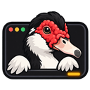
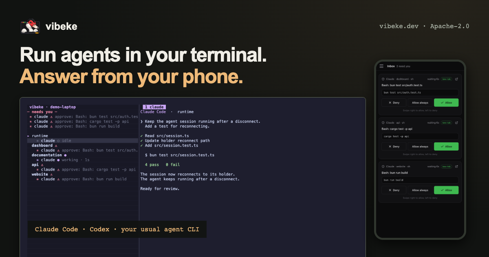

# Vibeke

<p align="center">
  
</p>

**Run agents in your terminal. Answer from your phone.**

Bring Claude Code, Codex, and your other agent CLIs into one workspace.
Run them on your laptop or an SSH host.
Pair your phone to answer supported requests.
Keep using your usual agent commands.

[Install](#install) · [Watch the full tour](https://vibeke.dev/?utm_source=github&utm_medium=readme#tour) · [Documentation](https://vibeke.dev/docs) · [Website](https://vibeke.dev/?utm_source=github&utm_medium=readme)

[](https://vibeke.dev/?utm_source=github&utm_medium=readme#demo)

- **Know which agent needs you.** Keep questions and permission requests in one inbox. Answer through the supported agent integration.
- **Reconnect to work in progress.** Agents keep running after a client disconnect or server restart. A host restart stops the processes.
- **Work across devices.** Use your terminal, the desktop app, or a paired browser. Your host must stay awake and connected.

## Install

The host CLI runs on **macOS 13+** (Apple silicon or Intel) and **Linux** (x86_64 or ARM64).
Install `minisign` first: `brew install minisign` on macOS, or use your Linux package manager.

```sh
curl -fsSL https://vibeke.dev/install.sh | sh
```

The installer verifies the release signature and checksums.
See [installation requirements](https://vibeke.dev/docs/install).

Start in your project:

```sh
cd your-project
vibeke
```

Complete first-run setup.
Run `claude`, `codex`, or your usual agent command inside the pane.
Press **Ctrl+B**, then **:** to open the command palette.
Start with one task, such as adding a test to your project.
Open the inbox when your agent needs an answer.
See the [quickstart](https://vibeke.dev/docs/quickstart).

**Want to try Vibeke later? Star this repository to find it again.**

### Add another screen

[Download the desktop app](https://vibeke.dev/docs/desktop) for macOS, Linux, or Windows.
The desktop app connects to a host. It does not bundle the CLI.
Local use requires the CLI on a supported Mac or Linux computer.
Windows connects to a supported remote host.

To pair your phone, open **Devices** on the host and choose **Pair a phone**.
You can also use `vibeke gateway pair`.
Confirm the pairing to connect the [browser app](https://app.vibeke.dev).
See [phone and browser access](https://vibeke.dev/docs/mobile).

## A few things to try

### Preview an app on your devbox

Run your app on an SSH host.
Open its preview beside the agent in your local terminal.
Browser panes need Chromium and a terminal that supports graphics.
[Watch the example](https://vibeke.dev/?utm_source=github&utm_medium=readme&t=32#tour) · [Previews guide](https://vibeke.dev/docs/previews)

### Ask another agent for a review

Name a pane `@reviewer`.
Send a request from another agent pane in the same workspace:

```text
@reviewer please check the changes in src/auth.rs
```

Mentions work with the Claude Code and Codex integrations.
Messages wait until the receiving agent is idle.
[Set up agent mentions](https://vibeke.dev/docs/mentions)

### Point at what you want to change

Open your app in a browser pane.
Choose **Annotate page** in the command palette.
Pick an element and write a note.
Send the notes to your agent with the selected element and a screenshot.
[Page annotations](https://vibeke.dev/docs/previews#annotate-a-page-for-an-agent)

## More capabilities

- **Separate tasks.** Give each task its own worktree, branch, and port range. Review changes before accepting them. [Tasks](https://vibeke.dev/docs/tasks)
- **Optional isolation.** Choose a supported OS sandbox, container, or VM. Worktrees alone do not restrict process access. [Execution and isolation](https://vibeke.dev/docs/sandboxes)
- **Sharing and handoffs.** Give a teammate view or approval access. Transfer code changes and supported agent sessions between paired hosts. [Sharing and handoffs](https://vibeke.dev/docs/handoff)
- **Agent integrations.** Use Claude Code, Codex, pi, omp, OpenCode, Hermes Agent, Gemini CLI, or an ACP agent. Structured features vary by integration. [Agents](https://vibeke.dev/docs/agents)
- **Automation.** Control Vibeke through its CLI, JSON-RPC API, or MCP server. [Control API](https://vibeke.dev/docs/api)
- **Plugins and migration.** Load native plugins with declared capabilities. Import supported Herdr configuration and layouts. [Migration guide](https://vibeke.dev/docs/migrating-from-herdr)

## How it works

Vibeke runs inside your terminal.
It uses Ghostty's VT engine.
A separate holder process owns each pane, so a server restart does not stop its agent.
Remote device traffic passes through an end-to-end encrypted relay.

<details>
<summary>View the architecture</summary>


[Process durability](https://vibeke.dev/docs/holders) · [Security model](https://vibeke.dev/docs/security)

</details>

## Documentation and contributions

[Quickstart](https://vibeke.dev/docs/quickstart) · [CLI reference](https://vibeke.dev/docs/cli) · [Configuration](https://vibeke.dev/docs/config) · [All documentation](https://vibeke.dev/docs)

Tried Vibeke? Tell us which part of your workflow it helped with.
[Open an issue](https://github.com/vibeke-ai/vibeke/issues) about what got in the way.
Include your Vibeke version, operating system, and steps to reproduce a problem.
Remove secrets and private project data before sharing logs or screenshots.

For source builds, see the [development guide](https://vibeke.dev/docs/development).
Read [AGENTS.md](AGENTS.md) before contributing code.

## License

Vibeke is licensed under the [Apache License 2.0](LICENSE).

## Inspiration and related work

Vibeke takes inspiration from [Herdr](https://herdr.dev/), particularly its approach to organizing coding agents in terminal workspaces and its plugin ecosystem.

There is a rich body of related work here. [cmux](https://cmux.com/) brings agent notifications and a programmable browser into terminal workspaces. [Paseo](https://paseo.sh/) makes coding agents accessible across machines and devices. [Conductor](https://www.conductor.build/docs), [Emdash](https://emdash.com/docs), and [Superset](https://docs.superset.sh/overview) explore parallel agents, isolated workspaces, and review workflows. [Solo](https://soloterm.com/docs) brings agent CLIs and development services together, while [Warp](https://www.warp.dev/) explores integrated terminal and agent workflows. These projects deserve recognition alongside the foundations established by [tmux](https://github.com/tmux/tmux/wiki) and [Zellij](https://zellij.dev/).

We created Vibeke to bring together the workflow we wanted: keep using our usual agent commands, run work on our own laptops and remote machines, and follow up from a terminal, browser, or phone. Its built-in, end-to-end encrypted relay makes hosts reachable without opening inbound ports or configuring a VPN.

We also wanted to make that work easier to share: invite teammates to view panes or help with approvals, and hand off code changes and supported agent sessions so someone else can pick up where we left off. Vibeke brings these capabilities together with structured agent integrations and processes that survive server restarts.

Special thanks to [Ghostty](https://ghostty.org/), whose `libghostty-vt` provides Vibeke’s terminal engine, and to the maintainers and contributors behind these projects.
