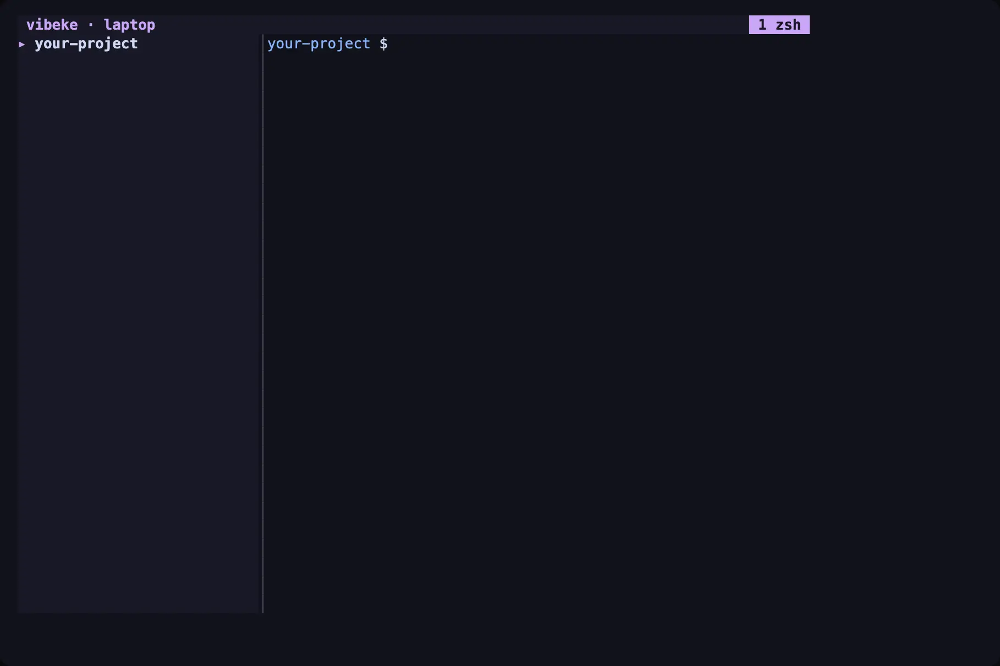

# Your first task

A task gives an agent its own git worktree and branch. In this guide you create a task, start an agent in it, answer a request, review the result and clean up.

You need a git repository and a running Vibeke session. See the [quickstart](quickstart.md).

## 1. Create the task

In the terminal interface, focus a pane that is inside your repository. Then press `prefix` then `shift+k`, or run **New task (git worktree)** from the command palette (`prefix` then `:`).

Type a title, for example `Add input checks`, and press Enter. Vibeke creates a branch and a worktree for the repository of the focused pane. It opens the worktree as a workspace and focuses it.



By default the worktree is under `~/.vibeke/worktrees`, and the branch name follows `{user}/{slug}`. Change this in the [`[tasks]` settings](reference/config.md). If your repository has a setup script (`.vibeke/setup.sh`), Vibeke runs it in the new worktree. A repository that Vibeke does not trust yet needs your approval first. See [tasks and review](concepts/tasks.md).

From a shell, the same step is:

```sh
vibeke task new "Add input checks" --repo . --agent claude
```

With `--agent`, Vibeke also starts the agent in the new worktree. Skip it to start the agent yourself.

## 2. Start an agent

If you did not use `--agent`, run your agent command in the shell pane of the new workspace:

```sh
claude
```

Give the agent its work. The agent works in the task worktree, so your main checkout keeps its state. A worktree is not a security boundary: at the host execution level, the agent can still write anywhere your user can. See [execution levels](concepts/sandboxes.md).

## 3. Watch its state

The sidebar lists the workspace of the task with the state of its agent. The state shows when the agent works, waits for you or is idle. A task you track also shows a review label, for example **Changes to inspect** or **Ready for your review**.

## 4. Answer a request

When the agent needs permission or asks a question, it appears in the attention inbox. Press `prefix` then `i`.

1. Select the request and read its details.
2. Enter or choose your answer.
3. Send it.

The answer goes to the agent through its own interface. See [agents and interactions](concepts/agents.md). You can also answer from your phone. See [answer agents from your phone](phone-quickstart.md).

## 5. Review the result

Open the task details. Press `prefix` then `g` and choose the task. **Task details for this agent** in the palette also works when the agent run belongs to the task, for example when you started it with `--agent`.

The view shows the requirements, the commands the agent ran, the checks and the review state. In this view:

- Press `v` to run a defined check. Vibeke asks you to authorize a check before its first run for a revision.
- Press `o` to open the agent pane.
- Press `w` to send the agent a message.
- Press `m` to record that you accept the result. Vibeke offers this for a committed revision. If the agent left uncommitted work, press `s` in the review to snapshot it first.

Accepting a review records your decision. It does not merge or finish the task.

To read the diff from a shell, use the review methods of the [API](reference/api.md), for example `task.review.diff`. You can also run `git diff` in the task worktree.

## 6. Merge or clean up

Vibeke does not merge for you by default. Merge the task branch with your usual git workflow, or queue it:

```sh
vibeke merge add <task> --target main
vibeke merge run
```

Then finish the task:

```sh
vibeke task finish <task> --remove-worktree
```

To stop the agents and delete the worktree but keep the branch, run `vibeke task archive <task>`. To pause and continue later, run `vibeke task park <task>` and `vibeke task resume <task>`.

## Next steps

- [Tasks and review](concepts/tasks.md): requirements, checks, review agents and shared-checkout collisions.
- [Answer agents from your phone](phone-quickstart.md): respond to requests away from your desk.
- [CLI reference](reference/cli.md): all `vibeke task` and `vibeke merge` commands.
