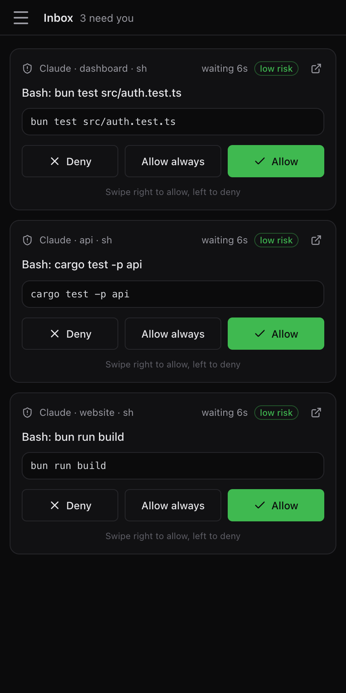

# Answer agents from your phone

This guide gets you from a running host to answering an agent request on your phone. The details are in [phone and browser access](mobile.md).

You need a host with a running Vibeke session. See the [quickstart](quickstart.md).

## 1. Pair your phone

Choose one way.

In the terminal interface, press `prefix` then `alt+d` to open **Connections**. You can also run **Pair a phone** from the command palette. Choose the access level and press Enter. A QR code appears.

Or run this in a shell on the host:

```sh
vibeke gateway pair
```

The first time, the command needs a relay and may ask you to sign in. For the hosted relay with an account:

```sh
vibeke gateway pair \
  --relay https://cloud.vibeke.dev \
  --app-url https://app.vibeke.dev
```

## 2. Open the app

Scan the QR code with your phone, or open the printed link. The link opens [app.vibeke.dev](https://app.vibeke.dev).

Compare the device fingerprint on the phone with the one in the terminal. Confirm on both sides. Each invitation works once and expires.

## 3. Install it to your home screen

On iOS or iPadOS, open the app in Safari. Choose **Share**, then **Add to Home Screen**. Open the installed app, then pair it. Push notifications on iOS need version 16.4 or later.

## 4. Turn on notifications

In the app, go to **Settings**, then **Alerts**, then **Turn on**. Allow notifications. Choose **When an agent needs you** to get a message when a request waits. Set this on each device.

## 5. Answer a request

When an agent asks for permission or asks a question, the app shows it and sends a notification. Open it, read the request, choose or type your answer and send it.



The host must stay awake and online. Closing the terminal does not stop your agents.

## Limits

- Pair with `--scope approve` or `--scope view` for limited access. A view-only device cannot start agents.
- Run `vibeke gateway status` if the phone cannot connect.
- Revoke a phone in **Connections** or with `vibeke gateway revoke <id>`.

## Next steps

- [Phone and browser access](mobile.md): accounts, devices, offline use, previews and sharing into an agent.
- [Your first task](first-task.md): start work that you can answer from anywhere.
- [Security](security.md): how access to your host is limited.
