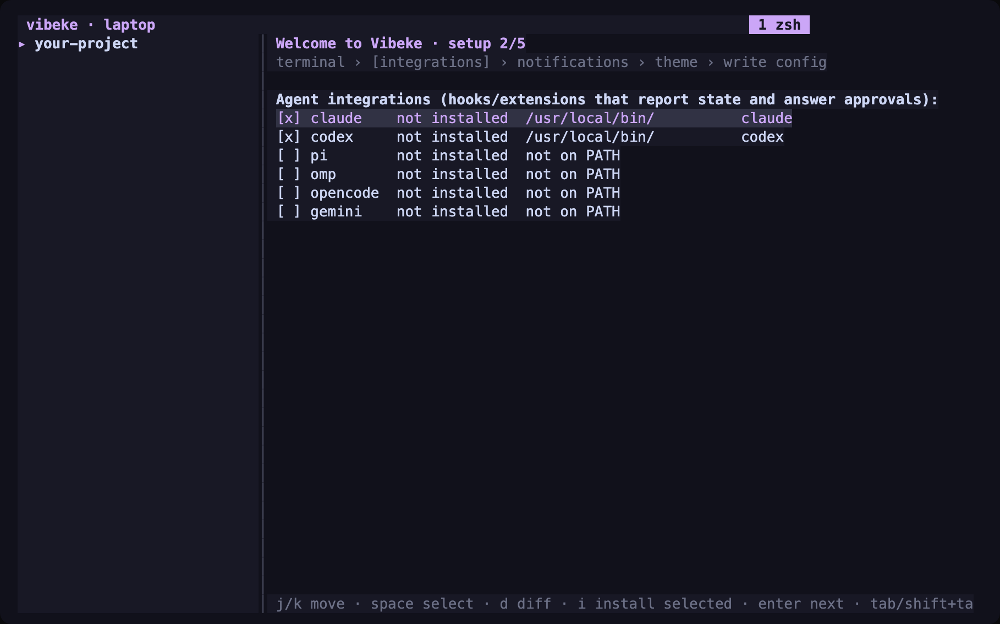
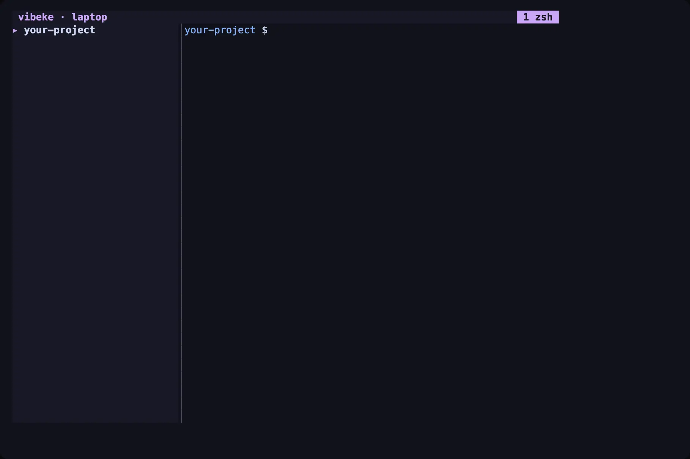
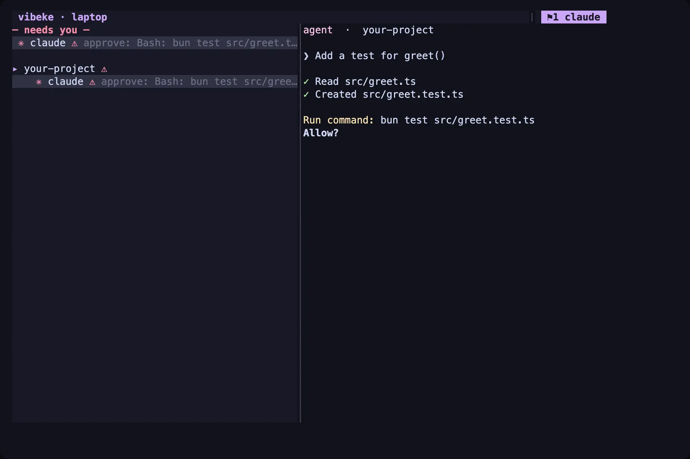

# Your first workspace

Install [Vibeke](install.md) and your preferred agent CLI. Authenticate the agent with its provider before starting.

## Start in your project

In your terminal, change to your project directory and start Vibeke:

```sh
cd your-project
vibeke
```

Vibeke starts its server when needed. A fresh session creates a workspace in your current directory.
An existing session reconnects to its workspaces. Use **New workspace** in the command palette to add another project.

## Complete first-run setup

The setup screen checks your terminal and offers agent integrations, notifications, and a theme.
Select the integrations you use, review their changes, and confirm installation.
Save the configuration when you finish. You can reopen **Setup** from the command palette at any time.



Integrations report structured agent state and deliver supported answers.

## Start your agent

At the shell prompt inside a pane, run your usual agent command:

```sh
claude
```

Or run `codex`, `pi`, `omp`, or another installed agent CLI.
The sidebar shows agent state when an integration or terminal detection is available.

## Find your way around

Press **Ctrl+B**, release both keys, then press the key in this table.
Wait a moment instead, and a menu shows every key.

| Key | Action |
| --- | --- |
| `:` | Open the command palette. Type an action name and press Enter. |
| `?` | Show every key in a menu. |
| `v` | Split the pane side by side. |
| `c` | Create a tab. |
| `w` | Navigate workspaces in the sidebar. |
| `i` | Open the attention inbox. |
| `q` | Detach this terminal client. |



For an agent request, open the inbox, review the details, and send your answer.
Supported integrations deliver the answer through the agent's own interface.



See [using the terminal interface](terminal.md) for more controls.

## Disconnect and reconnect

Detach with **Ctrl+B**, then **q**, or close the terminal. Run `vibeke` again to reconnect.
Holder processes keep panes active after a client disconnect or server restart.
A host restart stops these processes. Screen recovery after a server restart can be incomplete.

See [process durability](concepts/holders.md).

## Next steps

- [Run your first task](first-task.md) in a separate git worktree and review the result.
- [Answer agents from your phone](phone-quickstart.md).
- [Connect the desktop app](desktop.md) to your local or remote host.
- [Connect through SSH](remote.md) to work on another machine.

Run `vibeke doctor` if something does not work. It checks your installation, terminal, sockets, and integrations.
